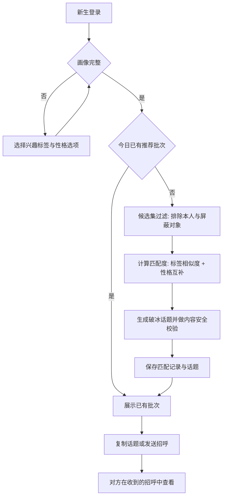
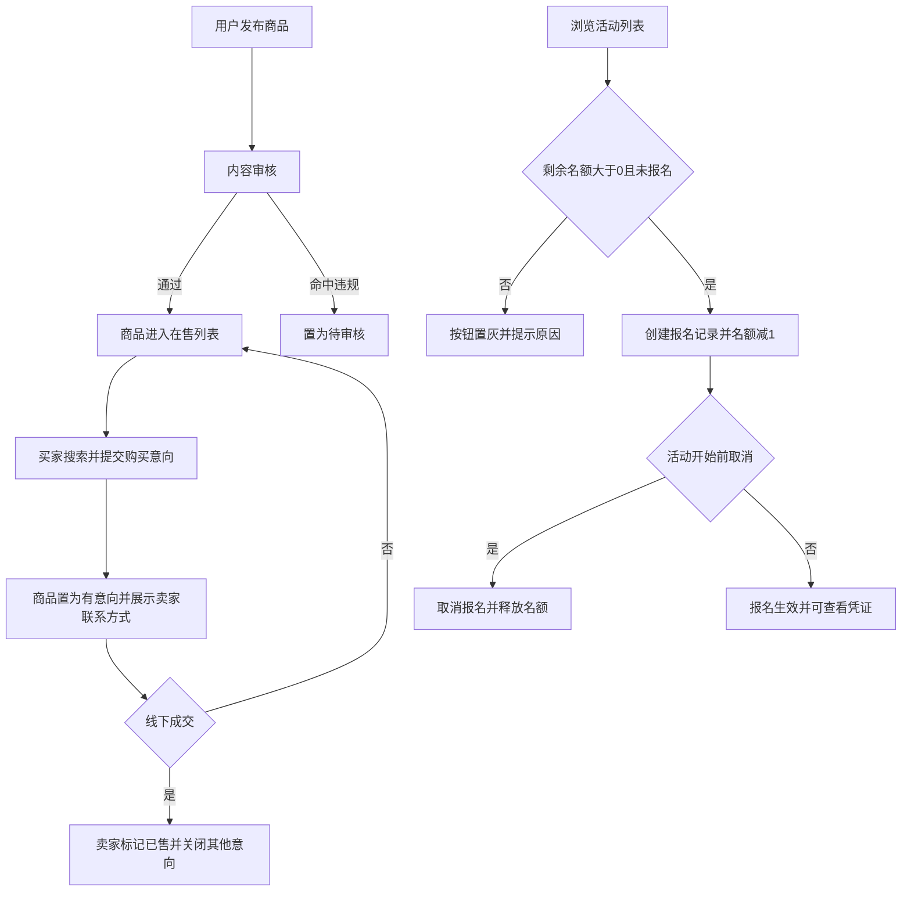

# 需求规范：【码道】新声——大一新生“破冰·学业·生活”全能赋能平台

## 文档信息

| 项目 | 内容 |
| --- | --- |
| 文档名称 | 新声平台需求规范（EARS 格式） |
| 版本 | v1.0.0 |
| 日期 | 2026-11-13 |
| 状态 | 待评审（Draft for Review） |
| 作者角色 | 华为云 CodeArts 全栈开发工程师（高校竞赛参赛者） |
| 适用范围 | 竞赛提交材料、3 分钟 Demo 视频脚本依据、研发与测试验收基线 |
| 需求编号规则 | 功能需求 FR-XXX、非功能需求 NFR-XXX、验收标准 AC-XXX、用户故事 US-XXX，编号一经分配不复用 |

---

## 1. 项目概述

### 1.1 背景

大一新生入学首月普遍面临三类断层：一是**社交断层**，同班同寝之外缺少结识渠道，社恐与“怕打扰别人”的心理导致社交启动困难；二是**学业断层**，大学自主学习节奏与中学差异大，笔记整理、课程复习缺少方法；三是**生活断层**，二手交易、失物招领、社团与讲座信息散落在多个微信群和公告栏，检索成本高。

### 1.2 目标

构建一个轻量化 Web 综合平台，用**一个入口**承载“破冰交友、学霸互助、生活服务”三大场景，并借助华为云大模型能力把“需要人主动组织”的环节自动化，降低新生参与门槛。

### 1.3 价值主张

1. **对新生**：3 步完成画像，每日获得可直接使用的搭子推荐与破冰话题；上传笔记即可获得思维导图、知识点摘要与复习练习题；校园信息一屏可查、一键报名。
2. **对学校与社团**：以极低的运营成本触达新生，活动报名数据可统计。
3. **对竞赛评审**：三大模块均具备“AI 真实调用 + 可见产出”的演示闭环，可在 3 分钟内完整呈现。

### 1.4 目标用户画像

| 画像 | 特征 | 核心诉求 |
| --- | --- | --- |
| 新生用户（主用户） | 18–19 岁，大一在读，手机为主、PC 为辅，社交意愿中等偏低，学习工具使用经验有限 | 快速找到同频搭子、降低社交启动成本、高效整理笔记、获取可信校园信息 |
| 社团负责人（轻量角色） | 由管理员代操作或共用管理员账号 | 发布招新与活动信息、查看报名名单 |
| 管理员（运营者） | 竞赛团队内部人员 | 内容审核、数据重置、演示保障 |

### 1.5 成功指标

| 指标 | 目标值 | 度量方式 |
| --- | --- | --- |
| 核心流程演示完整率 | 100% | 3 分钟 Demo 内三大模块主流程各走通一次 |
| AI 结构化产出成功率 | ≥ 95% | 思维导图、摘要、练习题三类产出可解析比例 |
| 首屏加载时间 | ≤ 2 秒 | 演示环境实测（校园网/热点） |
| 每日推荐可用率 | 100% | 连续 7 日每日均有推荐结果返回 |
| 内容安全拦截有效性 | 100% | 违规样本测试集全部被拦截或转人工 |

---

## 2. 范围

### 2.1 In Scope（本期实现）

1. 新生注册/登录与个人画像（兴趣标签、性格倾向、社交偏好）维护。
2. AI 搭子匹配：每日推荐、匹配度说明、破冰话题生成、发起招呼。
3. 学霸互助圈：搭子招募帖发布/浏览/报名、笔记上传（图片与 PDF）、OCR 文本识别、思维导图、知识点摘要、复习练习题生成。
4. 校园生活百宝箱：二手闲置发布与浏览、失物招领发布与认领、社团招新展示、活动/讲座展示与线上报名。
5. 管理端：内容审核、演示数据一键重置、关键操作日志查看。

### 2.2 Out of Scope（本期不做）

1. 真实资金支付、担保交易、物流对接（二手交易仅停留在“意向确认 + 线下自提”）。
2. 即时通讯（IM）与好友关系链；招呼以“一次性留言 + 联系方式展示”实现。
3. 原生移动 App、小程序端；仅提供响应式 Web 页面。
4. 学籍实名认证与学校统一身份系统对接（以学号后四位 + 昵称的轻量方式标识）。
5. 推荐算法的离线训练与长期画像学习；本期仅为规则加权 + 大模型语义辅助。
6. 多租户、多校区隔离与跨校数据互通。

### 2.3 假设与依赖

1. **假设 H1**：竞赛演示环境为单机可运行或单实例云主机，在线用户数不超过 50。
2. **假设 H2**：演示所用图片、PDF、商品与活动数据均由团队预置，不含真实隐私数据。
3. **假设 H3**：华为云大模型服务与 OCR 服务在演示期间可正常调用，团队已准备可切换的备用模型与本地缓存兜底。
4. **依赖 D1**：华为云 CodeArts IDE 作为开发环境。
5. **依赖 D2**：华为云大模型服务（ModelArts / 盘古 / DeepSeek 等）提供对话补全能力，接口协议兼容 OpenAI Chat Completions 形式。
6. **依赖 D3**：华为云 OCR 服务提供图片与 PDF 文本识别能力。
7. **依赖 D4**：对象存储（华为云 OBS 或等价轻量存储）用于图片与 PDF 访问。
8. **依赖 D5**：轻量关系型存储（SQLite 或等价）用于业务数据持久化。

---

## 3. 用户角色与权限

| 角色 | 定位 | 关键权限 | 明确限制 |
| --- | --- | --- | --- |
| 新生用户 | 平台主用户 | 维护个人画像；查看每日搭子推荐与破冰话题；发布/报名搭子招募；上传笔记并获取 AI 产出；发布二手商品与失物招领；浏览社团与活动并报名 | 不可查看他人隐私字段；不可删除他人发布内容；不可绕过内容审核 |
| 社团负责人 | 活动信息发布者（本期与管理员共用后台） | 发布/编辑社团与活动信息，导出报名名单 | 不可修改用户画像与匹配结果 |
| 管理员 | 平台运营者 | 内容审核与下架、用户封禁、演示数据重置、查看操作日志 | 不可将用户数据用于非审核用途；不可查看用户口令 |

权限规则：

1. 所有发布类操作（招募帖、二手商品、失物招领、活动）必须经过内容审核状态校验后才对外可见。
2. 涉及“本人内容”的编辑与下架，仅发布者本人与管理员可执行。
3. 管理端入口必须独立路径且需二次口令校验。

---

## 4. 用户故事与场景

### 4.1 模块 A：AI 破冰交友

**US-001 建立个人画像**
作为新生用户，我希望用标签和几个选项快速描述自己的兴趣与性格，以便系统了解我而无需填写长问卷。 验收要点：选择 ≥3 个兴趣标签、完成性格倾向与社交偏好选择后可保存；保存后画像在个人中心可见并可修改。

**US-002 获取每日搭子推荐**
作为社恐的新生用户，我希望每天打开平台就能看到为我筛选好的搭子，以便不必主动搜索就能开始社交。 验收要点：进入模块后 3 秒内展示 3 条推荐；每条包含昵称、共同标签、匹配度分值与匹配理由；当日已推荐则不重复生成新批次。

**US-003 获得可用的破冰话题**
作为不知道如何开口的新生，我希望系统直接给出几句可直接发送的开场白，以便我复制后即可发起对话。 验收要点：每条推荐至少生成 3 条破冰话题；话题中至少 1 条引用双方共同标签；点击可复制到剪贴板。

**US-004 发起招呼**
作为新生用户，我希望一键向搭子发送招呼并表达意向，以便把匹配转为真实接触。 验收要点：发送后对方在“收到的招呼”列表中可见；同一用户对同一对象 24 小时内最多发送 3 次。

### 4.2 模块 B：学霸互助圈

**US-005 发布学习搭子招募**
作为准备期末复习的新生，我希望发布一条晚自习/复习搭子招募，以便快速聚合同目标的同学。 验收要点：需填写标题、类型（晚自习/期末复习/其他）、时间、地点、人数上限；发布后进入“待审核”或直接可见（演示模式），并在列表首屏出现。

**US-006 报名他人招募**
作为新生用户，我希望看到招募帖并一键报名，以便加入学习小组。 验收要点：报名成功后名额减 1；名额已满时按钮置灰并提示；可取消报名并释放名额。

**US-007 上传笔记获取学习材料**
作为新生用户，我希望上传课堂笔记的照片或 PDF，自动得到思维导图、知识点摘要与复习练习题，以便提升复习效率。 验收要点：上传后显示处理进度；完成后同页展示三类产出；单份笔记处理在 60 秒内返回结果或给出明确失败提示。

**US-008 复习自测**
作为新生用户，我希望用自动生成的练习题自测并查看参考答案，以便检验复习效果。 验收要点：每份笔记至少生成 5 道题；可逐题展开答案；答案不可默认展开。

### 4.3 模块 C：校园生活百宝箱

**US-009 发布闲置物品**
作为新生用户，我希望把闲置物品拍照发布并标价，以便快速出手。 验收要点：需填写标题、价格、成色、交易地点、至少 1 张图片；发布后出现在列表并可被搜索到。

**US-010 表达购买意向**
作为买家，我希望对商品发起“我想要”意向并看到卖家联系方式，以便线下成交。 验收要点：意向提交后商品状态变为“有意向”；卖家联系方式按规则展示；同一商品可存在多条意向。

**US-011 发布与认领失物**
作为失主或拾获者，我希望发布失物/招领信息并可标记认领，以便物品归还。 验收要点：失物与招领分两类展示；认领需填写认领说明；确认归还后状态变更为“已归还”并从前台主列表移除。

**US-012 浏览社团与活动并报名**
作为新生用户，我希望在一个页面看到社团招新与近期讲座活动并直接报名，以便不再翻找多个群公告。 验收要点：活动按开始时间升序展示；报名成功后显示“已报名”并占用名额；活动开始前可取消报名。

### 4.4 跨模块场景（Demo 主流程）

**US-013 3 分钟闭环体验**
作为竞赛评审，我希望在 3 分钟内看到“填画像 → 拿到搭子与破冰话题 → 发布招募/上传笔记拿到导图与练习题 → 浏览二手与活动并完成报名”的完整闭环，以便判断产品价值。 验收要点：预置演示账号下，三大模块各主流程操作步骤合计不超过 12 次点击；无阻塞性报错。

---

## 5. 功能需求（EARS）

### 5.1 模块 A：AI 破冰交友

- **FR-001 画像必填校验**：当新生用户首次进入「破冰」模块时，系统应要求其选择至少 3 个兴趣标签、1 项性格倾向与 1 项社交偏好，未满足时不得进入匹配。（追溯 US-001；AC-001）
- **FR-002 画像保存与更新**：当新生用户提交画像时，系统应持久化保存标签与性格信息，并在个人中心以可编辑形式回显。（追溯 US-001；AC-001）
- **FR-003 标签候选与数量上限**：系统应提供不少于 20 个预置兴趣标签，并允许用户多选，单用户标签数量上限为 10 个。（追溯 US-001；AC-002）
- **FR-004 每日推荐生成**：当新生用户当日尚无推荐记录且画像完整时，系统应生成 3 条搭子推荐并记录批次生成时间。（追溯 US-002；AC-003）
- **FR-005 推荐去重与配额**：若用户当日已获得推荐批次，则系统应直接返回已有批次而不重复生成；同一被推荐对象在 7 日内不得重复出现。（追溯 US-002；AC-003）
- **FR-006 匹配度计算**：系统应基于共同兴趣标签数量、标签相似度与性格互补规则计算 0–100 的整数匹配度分值，并在推荐卡片上展示。（追溯 US-002；AC-004）
- **FR-007 匹配理由说明**：当展示推荐卡片时，系统应给出至少 1 条可读匹配理由，理由中至少包含 1 个共同标签。（追溯 US-002；AC-004）
- **FR-008 破冰话题生成**：当推荐批次生成成功时，系统应为每条推荐生成不少于 3 条破冰话题，单条长度在 15–60 字之间。（追溯 US-003；AC-005）
- **FR-009 话题一键复制**：当用户点击某条破冰话题的复制按钮时，系统应将该话题文本写入剪贴板并给出“已复制”提示。（追溯 US-003；AC-005）
- **FR-010 手动换一批**：若用户对当日推荐点击“换一批”，则系统应保留已发出的招呼记录并重新生成 1 次新批次，当日刷新次数上限为 1 次。（追溯 US-002；AC-006）
- **FR-011 发送招呼**：当用户点击“打招呼”并填写不超过 100 字的留言时，系统应创建招呼记录，并使双方可在招呼列表中查看。（追溯 US-004；AC-007）
- **FR-012 招呼频次限制**：若同一用户对同一目标对象在 24 小时内已发送 3 次招呼，则系统应拒绝第 4 次并提示“今日招呼次数已达上限”。（追溯 US-004；AC-007）
- **FR-013 推荐候选过滤**：当生成推荐时，系统应排除本人、已被本人屏蔽的对象以及画像不完整的用户。（追溯 US-002；AC-006）

### 5.2 模块 B：学霸互助圈

- **FR-014 招募帖发布**：当用户提交的招募帖标题、类型、时间、地点、人数上限均填写完整时，系统应创建招募帖并置为“待审核”（演示模式下可直接置为“已发布”）。（追溯 US-005；AC-008）
- **FR-015 招募帖字段校验**：若人数上限小于 2 或活动时间早于当前时间，则系统应拒绝提交并返回字段级错误提示。（追溯 US-005；AC-008）
- **FR-016 招募帖浏览与筛选**：当用户进入学霸互助圈时，系统应按创建时间倒序展示招募帖，并支持按类型与关键词筛选。（追溯 US-005；AC-009）
- **FR-017 报名招募**：当用户对尚有剩余名额的招募帖点击报名时，系统应创建报名记录并将已报名人数加 1。（追溯 US-006；AC-009）
- **FR-018 名额已满拦截**：若招募帖已报名人数等于人数上限，则系统应禁用报名入口并提示“名额已满”。（追溯 US-006；AC-010）
- **FR-019 取消报名**：当用户取消本人报名时，系统应将报名记录置为“已取消”并释放 1 个名额。（追溯 US-006；AC-010）
- **FR-020 笔记文件接收**：当用户上传 jpg/png/webp/pdf 格式且不超过 20MB 的笔记文件时，系统应接收文件并创建笔记记录。（追溯 US-007；AC-011）
- **FR-021 上传非法输入处理**：若文件超过 20MB 或格式不被支持，则系统应拒绝上传并提示允许的格式清单与体积上限。（追溯 US-007；AC-011）
- **FR-022 OCR 文本识别**：当笔记文件接收成功后，系统应调用 OCR 服务提取文本，并将识别文本与字符数持久化到该笔记记录。（追溯 US-007；AC-012）
- **FR-023 处理进度展示**：当笔记处于处理流程中时，系统应在页面展示“识别中／生成中／完成／失败”状态之一，并至少每 2 秒刷新一次进度。（追溯 US-007；AC-012）
- **FR-024 思维导图生成**：当 OCR 文本非空时，系统应生成层级不少于 2 层、节点数不少于 8 的结构化思维导图，并以树形结构在页面渲染。（追溯 US-007；AC-013）
- **FR-025 知识点摘要生成**：当 OCR 文本非空时，系统应生成 5–10 条知识点摘要，单条不超过 80 字。（追溯 US-007；AC-013）
- **FR-026 复习练习题生成**：当 OCR 文本非空时，系统应生成不少于 5 道复习练习题，每题包含题干、参考答案与解析。（追溯 US-008；AC-014）
- **FR-027 答案默认隐藏**：当用户查看练习题时，系统应默认隐藏参考答案，点击“查看答案”后才展开对应答案与解析。（追溯 US-008；AC-014）
- **FR-028 识别失败兜底**：若 OCR 有效字符少于 20 个，则系统应将笔记置为“失败”并提示“未能识别到有效文字，请检查图片清晰度或更换文件”。（追溯 US-007；AC-012）
- **FR-029 生成失败重试**：当大模型生成步骤失败时，系统应保留 OCR 文本并提供“重新生成”入口，同一笔记累计重试上限为 3 次。（追溯 US-007；AC-015）
- **FR-030 笔记历史列表**：系统应按上传时间倒序列出用户本人的笔记与处理状态，并支持重新进入详情查看产出。（追溯 US-007；AC-013）

### 5.3 模块 C：校园生活百宝箱

- **FR-031 二手商品发布**：当用户提交的商品标题、价格、成色、交易地点与至少 1 张图片齐备时，系统应创建商品记录并置为“在售”。（追溯 US-009；AC-016）
- **FR-032 商品字段校验**：若价格不在 0–9999 元区间或图片数量超过 6 张，则系统应拒绝发布并返回具体校验提示。（追溯 US-009；AC-016）
- **FR-033 商品浏览与搜索**：当用户进入二手区时，系统应展示“在售”商品列表，并支持按关键词与价格区间筛选。（追溯 US-009；AC-017）
- **FR-034 购买意向提交**：当用户对“在售”商品提交购买意向时，系统应记录意向、将商品置为“有意向”，并向买家展示卖家联系方式。（追溯 US-010；AC-017）
- **FR-035 商品状态流转**：当发布者标记商品为“已售”或“下架”时，系统应将商品移出默认列表，并将未关闭的意向统一置为“已关闭”。（追溯 US-009；AC-018）
- **FR-036 失物招领发布**：当用户提交的信息包含类型、物品描述、时间地点与联系方式时，系统应创建记录并按“失物／招领”分栏展示。（追溯 US-011；AC-019）
- **FR-037 认领处理**：当用户对招领信息提交不少于 10 字的认领说明时，系统应生成待确认认领申请；发布者确认后记录状态置为“已归还”。（追溯 US-011；AC-019）
- **FR-038 社团展示**：当用户进入社团专区时，系统应展示社团名称、简介、招新起止时间与联系方式，并按展示顺序号排序。（追溯 US-012；AC-020）
- **FR-039 活动聚合展示**：当用户进入活动专区时，系统应按开始时间升序展示未结束活动，并标注每场活动的剩余名额。（追溯 US-012；AC-020）
- **FR-040 活动报名**：当用户对剩余名额大于 0 的活动点击报名时，系统应创建报名记录、将剩余名额减 1，并在页面显示“已报名”。（追溯 US-012；AC-021）
- **FR-041 报名取消与截止**：若活动已开始，则系统应拒绝取消请求；活动开始前用户取消报名时，系统应释放 1 个名额。（追溯 US-012；AC-021）
- **FR-042 重复报名拦截**：若用户已报名同一活动或同一招募帖，则系统应返回“请勿重复报名”提示且不新增记录。（追溯 US-006、US-012；AC-021）

### 5.4 模块 D：平台通用与演示保障

- **FR-043 轻量注册登录**：当用户提交昵称、学号后四位与口令时，系统应完成注册或登录并建立会话，会话有效期不少于 2 小时。（追溯 US-001；AC-022）
- **FR-044 登录失败锁定**：若同一账号连续 5 次口令错误，则系统应锁定该账号 10 分钟并返回“尝试次数过多”提示。（追溯 US-001；AC-022）
- **FR-045 发布内容审核**：当用户发布招募帖、商品、失物招领或活动时，系统应对标题与正文执行违规词检测，命中时置为“待审核”并告知发布者。（追溯 US-005、US-009、US-012；AC-023）
- **FR-046 管理端下架**：当管理员对已发布内容执行下架时，系统应将其状态置为“已下架”并从前台可见列表中移除。（追溯 US-005；AC-023）
- **FR-047 演示数据重置**：当管理员触发“一键重置演示数据”时，系统应恢复预置账号、推荐批次、笔记产出与活动名额，且不影响已上传的演示素材文件。（追溯 US-013；AC-024）
- **FR-048 关键操作日志**：当发生登录、发布、审核、重置等关键操作时，系统应记录操作人、操作类型、对象标识与时间戳。（追溯 US-013；AC-024）

## 6. 非功能需求（NFR）

- **NFR-001 首屏性能**：在演示网络条件下，首页与三大模块列表页的首屏可交互时间应不超过 2 秒。
- **NFR-002 AI 响应时限**：破冰话题生成单次调用应在 8 秒内返回；笔记全链路（OCR + 三类生成）应在 60 秒内返回完成或失败状态。
- **NFR-003 并发能力**：系统应在 50 个并发会话下保持主流程可用，接口成功率不低于 99%。
- **NFR-004 可用性目标**：演示期内可用性目标为 99.5%；单个服务实例重启后应在 30 秒内恢复可访问。
- **NFR-005 数据持久化**：所有业务数据应落盘存储，服务重启后用户画像、匹配记录、笔记产出与报名记录不得丢失。
- **NFR-006 认证与会话安全**：口令应以不可逆方式存储；会话失效后受保护接口应返回 401 并要求重新登录。
- **NFR-007 隐私最小化**：仅采集完成业务所必需的字段；联系方式默认仅向已建立招呼或购买意向关系的用户展示。
- **NFR-008 内容安全过滤**：AI 生成的破冰话题与学习材料应经过敏感内容过滤；命中违规内容时整条丢弃并重新生成 1 次，仍失败则降级为预置模板文案。
- **NFR-009 浏览器兼容**：应支持 Chrome / Edge 最近两个大版本及移动端 Chrome，页面在 375px 宽度下不出现横向滚动。
- **NFR-010 可维护性**：关键路径应输出结构化日志（含请求标识、模块、耗时、结果状态），单次请求可凭请求标识串联全链路。
- **NFR-011 AI 调用降级**：当大模型服务超时或返回不可解析内容时，系统应自动切换备用模型；备用模型仍失败时使用本地预置模板返回可用结果，并在页面标注“降级结果”。
- **NFR-012 演示稳定性**：演示关键路径的 AI 产出应支持本地缓存回放，缓存命中时不发起外部调用，回放结果结构与真实调用一致。
- **NFR-013 资源占用**：单实例运行内存占用应不超过 2GB；演示数据规模下数据库文件应不超过 200MB。
- **NFR-014 可观测性**：应提供健康检查接口，返回服务状态、依赖（大模型、OCR、对象存储）连通性与版本号。

---

## 7. 数据实体与关系

### 7.1 核心实体与字段

| 实体 | 关键字段 | 约束说明 |
| --- | --- | --- |
| 用户 User | user_id、nickname、student_no_tail4、password_hash、personality、social_pref、contact、status、created_at | nickname 1–20 字且唯一；student_no_tail4 为 4 位数字；personality 取值为“内向／中性／外向”；social_pref 取值为“一对一深聊／小群体／随缘” |
| 兴趣标签 Tag | tag_id、tag_name、category | tag_name 唯一且不超过 10 字 |
| 用户标签关系 UserTag | user_id、tag_id | 单用户标签数 3–10 |
| 搭子匹配记录 MatchRecord | match_id、user_id、target_user_id、score、reason、batch_date、status | score 为 0–100 整数；同一用户同一批次唯一；7 日内同一目标不重复 |
| 破冰话题 IcebreakerTopic | topic_id、match_id、content、used_flag | 每条匹配记录至少 3 条；content 15–60 字 |
| 招呼 Greeting | greeting_id、from_user_id、to_user_id、message、created_at | message ≤100 字；同一对用户 24 小时内 ≤3 条 |
| 搭子招募帖 StudyPost | post_id、author_id、title、type、start_time、location、capacity、joined_count、status | type 取值为“晚自习／期末复习／其他”；capacity ≥2；joined_count ≤ capacity |
| 招募报名 StudySignup | signup_id、post_id、user_id、status | 同一用户同一招募帖唯一有效报名 |
| 笔记 Note | note_id、owner_id、file_url、file_type、file_size、status、created_at | file_type 取值为 jpg/png/webp/pdf；file_size ≤20MB；status 取值为“识别中／生成中／完成／失败” |
| OCR 文本 OcrText | ocr_id、note_id、raw_text、char_count | char_count <20 视为识别失败 |
| 思维导图 MindMap | map_id、note_id、structure_json | structure_json 层级 ≥2、节点 ≥8 |
| 知识点摘要 Summary | summary_id、note_id、content、seq | 单条 ≤80 字；单笔记 5–10 条 |
| 复习练习题 Exercise | exercise_id、note_id、question、answer、analysis、seq | 单笔记 ≥5 条 |
| 二手商品 SecondhandItem | item_id、seller_id、title、price、condition、trade_place、image_urls、status | price 为 0–9999 元；condition 取值为“全新／九成新／七成新／可用”；image_urls 1–6 张；status 取值为“在售／有意向／已售／已下架” |
| 购买意向 PurchaseIntent | intent_id、item_id、buyer_id、message、status | status 取值为“待响应／已确认／已关闭” |
| 失物招领 LostFound | lf_id、owner_id、type、item_desc、event_time、event_place、contact、status | type 取值为“失物／招领”；status 取值为“进行中／已归还／已关闭” |
| 认领申请 ClaimRequest | claim_id、lf_id、applicant_id、description、status | description 不少于 10 字；status 取值为“待确认／已确认／已拒绝” |
| 社团 Club | club_id、name、intro、recruit_start、recruit_end、contact、sort_no | recruit_end 晚于 recruit_start |
| 活动 Activity | activity_id、title、host、start_time、end_time、place、quota、remaining、status | remaining ≤ quota 且 ≥0 |
| 活动报名 ActivitySignup | signup_id、activity_id、user_id、status、created_at | 同一用户同一活动唯一有效报名 |
| 审核记录 AuditLog | audit_id、target_type、target_id、result、operator_id、created_at | target_type 覆盖招募帖／商品／失物招领／活动 |

---

## 8. 外部接口与依赖

| 接口／依赖 | 用途 | 调用时机 | 超时 | 失败降级策略 |
| --- | --- | --- | --- | --- |
| 华为云大模型（对话补全） | 生成破冰话题、思维导图结构、知识点摘要、复习练习题 | 推荐批次生成、笔记处理 | 8 秒（话题）／30 秒（笔记生成） | 先切备用模型；仍失败则用本地预置模板并在页面标注“降级结果”（NFR-011） |
| 华为云 OCR 服务 | 笔记图片/PDF 文本识别 | 文件上传成功后 | 20 秒 | 重试 1 次；仍失败则笔记置“失败”并提示重新上传 |
| 对象存储（OBS 或等价） | 存储笔记原文与商品图片 | 文件上传时 | 15 秒 | 降级为本地文件目录存储，对外访问路径保持不变 |
| 轻量数据库（SQLite 或等价） | 业务数据持久化 | 全程 | — | 不可用视为系统故障，健康检查返回不健康 |
| 违规词／内容安全能力 | 发布内容与 AI 产出过滤 | 发布时、生成后 | 3 秒 | 超时则转人工审核（置“待审核”）；AI 产出超时则整条丢弃重试 1 次，再失败用模板 |
| 地图／定位（可选） | 展示交易地点 | 商品详情 | 5 秒 | 不可用时仅展示文本地址 |

接口约束：

1. 所有外部调用必须记录耗时、状态码与请求标识。
2. 不得将完整用户隐私字段传入大模型提示词，仅传入昵称、兴趣标签与性格枚举值。
3. 外部依赖均可通过配置项开关切换，切换后无需修改业务代码。

---

## 9. 关键业务流程

### 9.1 破冰匹配流程

### 9.2 AI 笔记处理流程

1. 用户选择笔记文件提交，系统校验格式与体积。
2. 文件写入对象存储，创建笔记记录并置为“识别中”。
3. 调用 OCR 服务提取文本；有效字符少于 20 个则置为“失败”并提示重新上传。
4. 以 OCR 文本为输入，依次生成思维导图结构、知识点摘要与复习练习题，期间状态置为“生成中”。
5. 三类产出均通过内容安全与结构校验后落库，笔记状态置为“完成”。
6. 任一步骤失败则保留 OCR 文本，状态置为“失败”，页面提供“重新生成”（上限 3 次）。
7. 用户进入笔记详情查看树形导图、摘要列表与练习题，逐题展开答案。

### 9.3 二手交易与活动报名流程

---

## 10. 验收标准（Given/When/Then）

- **AC-001**：Given 新生用户已登录且画像为空，When 进入破冰模块，Then 页面停留在画像填写页并提示“请至少选择 3 个兴趣标签”，补全后方可进入匹配页。
- **AC-002**：Given 用户已选择 10 个兴趣标签，When 尝试选择第 11 个，Then 系统阻止选择并提示标签数量已达上限。
- **AC-003**：Given 用户画像完整且今日无推荐，When 打开推荐页，Then 3 秒内展示 3 条推荐；刷新页面后返回同一批次且批次生成时间不变。
- **AC-004**：Given 推荐卡片已展示，When 查看卡片内容，Then 可见 0–100 的匹配度分值与至少 1 条包含共同标签的匹配理由。
- **AC-005**：Given 某条推荐已生成，When 查看破冰话题，Then 至少 3 条话题可读；点击复制后出现“已复制”提示且剪贴板内容与话题一致。
- **AC-006**：Given 用户当日已刷新过一次推荐，When 再次点击“换一批”，Then 系统提示当日刷新次数已用完且推荐列表不变。
- **AC-007**：Given 用户 24 小时内已向同一对象发送 3 次招呼，When 再次发送，Then 请求被拒绝并提示“今日招呼次数已达上限”。
- **AC-008**：Given 用户填写招募帖且人数上限为 1，When 提交，Then 系统拒绝并提示人数上限至少为 2；改为 4 后可成功发布。
- **AC-009**：Given 招募帖已报名人数为 2、人数上限为 4，When 用户点击报名，Then 报名成功、已报名人数变为 3、按钮显示“已报名”。
- **AC-010**：Given 招募帖名额已满，When 用户查看该帖，Then 报名按钮不可用并提示“名额已满”；已报名用户取消后名额恢复为 1。
- **AC-011**：Given 用户选择 25MB 的 PDF 文件，When 提交上传，Then 系统拒绝并提示“文件不得超过 20MB”；改为 2MB 的 jpg 文件时上传成功。
- **AC-012**：Given 笔记上传成功，When 观察处理状态，Then 依次出现“识别中”“生成中”“完成”；若图片模糊导致有效字符少于 20 个，则状态为“失败”并给出重新上传提示。
- **AC-013**：Given 笔记处理完成，When 打开笔记详情，Then 可看到层级不少于 2 层的树形思维导图与 5–10 条知识点摘要，且摘要单条不超过 80 字。
- **AC-014**：Given 笔记处理完成，When 查看练习题区域，Then 至少 5 道题的参考答案默认隐藏，点击“查看答案”后展开对应答案与解析。
- **AC-015**：Given 大模型生成步骤失败，When 用户点击“重新生成”，Then 系统基于已有 OCR 文本重新生成且不要求重新上传文件；第 4 次点击时按钮不可用。
- **AC-016**：Given 用户填写商品价格为 12000 元，When 提交发布，Then 系统拒绝并提示价格应在 0–9999 元之间；改为 120 元并上传 1 张图片后发布成功。
- **AC-017**：Given 商品处于“在售”状态，When 买家提交购买意向，Then 商品状态变为“有意向”，买家页面显示卖家联系方式，卖家可在意向列表中看到该记录。
- **AC-018**：Given 商品已有 2 条意向，When 卖家标记“已售”，Then 商品从默认列表移除且 2 条意向状态均为“已关闭”。
- **AC-019**：Given 招领信息处于“进行中”，When 申请人提交不少于 10 字的认领说明，Then 生成待确认认领申请；发布者确认后状态变为“已归还”并从前台主列表移除。
- **AC-020**：Given 存在 3 场未结束活动，When 进入活动专区，Then 活动按开始时间升序展示并标注各自剩余名额。
- **AC-021**：Given 活动剩余名额为 1，When 用户报名，Then 报名成功、剩余名额变为 0、按钮显示“已报名”；该用户再次报名时提示“请勿重复报名”。
- **AC-022**：Given 用户连续 5 次输入错误口令，When 第 6 次尝试登录，Then 系统返回“尝试次数过多”并锁定账号 10 分钟。
- **AC-023**：Given 用户发布的商品标题命中违规词，When 提交发布，Then 商品状态为“待审核”且不出现在前台列表；管理员下架后状态为“已下架”且不可被搜索到。
- **AC-024**：Given 演示数据已被修改，When 管理员触发“一键重置演示数据”，Then 预置账号、推荐批次、笔记产出与活动名额恢复初始值，且重置操作被记入操作日志。

---

## 11. 里程碑与演示脚本

### 11.1 里程碑

| 里程碑 | 交付内容 | 验收口径 |
| --- | --- | --- |
| M0 需求与设计定稿 | 本规范、数据模型、接口清单 | 评审通过，FR/NFR 无未决冲突 |
| M1 平台底座 | 登录、数据库、对象存储、健康检查、日志 | AC-022 通过，NFR-005 验证通过 |
| M2 模块 A 闭环 | 画像、每日推荐、破冰话题、招呼 | AC-001 ～ AC-007 通过 |
| M3 模块 B 闭环 | 招募帖、笔记上传、OCR、三类产出 | AC-008 ～ AC-015 通过 |
| M4 模块 C 与管理端 | 二手、失物、社团活动、审核、重置 | AC-016 ～ AC-024 通过 |
| M5 演示打磨 | 缓存回放、降级演练、3 分钟脚本彩排 | 连续 3 次彩排无阻塞且全流程 ≤3 分钟 |

### 11.2 3 分钟 Demo 分镜

| 时间 | 镜头内容 | 操作要点 | 呈现价值 |
| --- | --- | --- | --- |
| 0:00–0:15 | 开场与首页 | 展示三大模块入口与一句话定位 | 说明“一个入口解决三类断层” |
| 0:15–0:50 | 破冰交友 | 选择 3 个标签与性格选项 → 展示 3 条推荐（含匹配度与共同标签）→ 复制一条破冰话题 → 发送招呼 | AI 匹配与话题生成的真实产出 |
| 0:50–1:45 | 学霸互助圈 | 发布一条期末复习招募帖 → 报名他人招募帖 → 上传预置笔记 PDF → 展示思维导图、摘要与练习题（展开 1 题答案） | AI 笔记助手的完整链路 |
| 1:45–2:30 | 生活百宝箱 | 浏览二手商品并提交购买意向 → 发布一条失物招领 → 在活动专区报名 1 场讲座 | 校园生活信息与报名闭环 |
| 2:30–2:50 | 管理与降级 | 展示待审核内容被下架、健康检查接口、AI 降级标注 | 体现内容安全与工程可靠性 |
| 2:50–3:00 | 收尾 | 回到首页，强调轻量、可复制、可推广 | 价值收敛与竞赛叙事 |

演示保障要求：全程使用预置账号与预置素材；关键 AI 产出提前缓存；现场若外网异常，切换至缓存回放模式并口头说明（NFR-012）。

---

## 12. 风险与开放问题

| 编号 | 风险／问题 | 影响 | 应对措施 | 状态 |
| --- | --- | --- | --- | --- |
| R-01 | 大模型输出结构不稳定（导图非结构化、摘要条数不足） | 页面渲染失败，演示中断 | 严格提示词模板 + 结构校验 + 重试 1 次 + 本地模板兜底 | 待验证 |
| R-02 | 大模型响应超时 | 笔记流程超过 60 秒，观感差 | 异步任务 + 进度轮询 + 超时降级（NFR-011） | 待验证 |
| R-03 | 演示现场网络不稳 | 外部调用全部失败 | 本地缓存回放 + 备用模型 + 现场热点备份 | 待演练 |
| R-04 | 内容安全合规（用户发布与 AI 生成） | 违规内容外显，评审扣分 | 违规词过滤 + 待审核机制 + AI 产出二次过滤 | 设计已定 |
| R-05 | 隐私合规（学号、联系方式） | 个人信息泄露风险 | 仅采集学号后四位；联系方式按关系可见；日志脱敏 | 待补充说明 |
| R-06 | 匹配冷启动候选不足 | 推荐质量低或为空 | 预置足量候选；候选不足时放宽标签约束并提示 | 待验证 |
| R-07 | OCR 对拍照笔记识别率低 | 学习材料不可用 | 演示使用清晰扫描件；失败时明确引导重新上传 | 待验证 |
| R-08 | 并发报名导致名额超卖 | 数据不一致 | 报名使用事务与条件更新（剩余名额大于 0 才扣减） | 设计已定 |
| Q-01 | 是否在演示中展示真实支付流程 | 影响范围与工期 | 建议维持 Out of Scope，仅展示“意向确认 + 线下自提” | 待确认 |
| Q-02 | 社团负责人是否需要独立账号体系 | 影响权限设计 | 建议本期与管理员共用后台 | 待确认 |
| Q-03 | 是否需要移动端优先布局 | 影响演示录制方式 | 建议响应式即可，录制以桌面端为主 | 待确认 |
| Q-04 | 是否接入学校统一身份认证 | 影响用户规模与合规 | 建议本期不接入 | 待确认 |

---

**文档结束**｜版本 v1.0.0｜共 48 条功能需求、14 条非功能需求、24 条验收标准